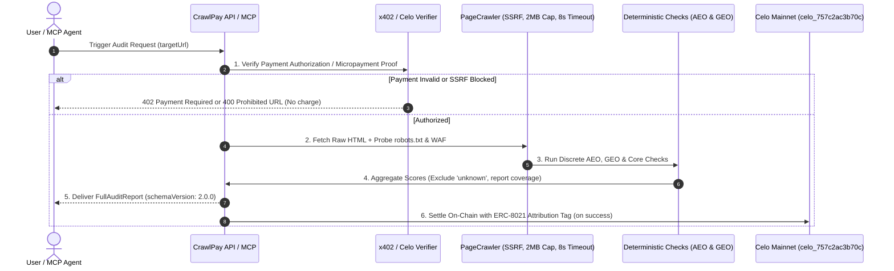

# 🗺️ CrawlPay AEO & GEO Integration Map & System Architecture (RFC 9309 & Production Aligned)

> **Deterministic Engineering Specification for Answer Engine Optimization (AEO) and Generative Engine Optimization (GEO) in CrawlPay**

---

## 📌 Executive Architecture & Payment Lifecycle



---

## 🛡️ Fetch & Security Layer (`src/utils/security.ts` & `PageCrawler`)

1. **SSRF Protection:** Pre-flight DNS validation via `isPrivateOrReservedIp()` blocking IPv4/IPv6 private ranges, loopback (`127.0.0.1`, `::1`), link-local, documentation blocks, Carrier Grade NAT, and cloud metadata endpoints (`169.254.169.254`).
2. **Deterministic Timeouts:** 4s timeout on `robots.txt`, 8s per-page HTTP timeout, 60s hard ceiling for entire crawl.
3. **Response Size Cap:** Hard 2MB response size limit per crawled document.
4. **Raw vs. Rendered HTML:** CrawlPay fetches **raw server-delivered HTML** (no headless browser overhead). If `bodyText.length < 250 && hasClientRoot`, the engine flags `isClientRendered: true`—a critical GEO barrier since many AI search bots (`GPTBot`, `PerplexityBot`) do not execute client-side JavaScript.
5. **AI User-Agent WAF Probe:** In addition to `robots.txt` policy, sends a lightweight HEAD/GET request with `User-Agent: GPTBot` to test if the edge WAF (Cloudflare/AWS) actively returns `403 Forbidden` or CAPTCHAs.

---

## 🔍 Discrete Engine Checks Specification

### 1. AEO Check Suite (`src/engine/checks/aeo/`)

| Check ID | Severity | Inspection Criteria & Evidence | Actionable Fix |
| :--- | :--- | :--- | :--- |
| `aeo.question_headings` | `Medium` | Inspects `<h2>` and `<h3>` tags for true interrogative starters: `what`, `how`, `why`, `when`, `where`, `who`, `which`, `can`, `does`, `is`, `should`. *(Strictly excludes commercial non-questions like "best" or "top").* | Rephrase procedural subheadings as explicit user questions to align with AI search query syntax. |
| `aeo.faq_schema` | `Low` | Scans parsed JSON-LD for `@type: "FAQPage"` or `"QAPage"`. Confirms syntax validity. *(Evaluated for machine & LLM extraction, not visual SERP accordions).* | Inject clean `FAQPage` JSON-LD schema matching visible page Q&A. |
| `aeo.structured_answers` | `Low` | Evaluates whether headings with procedural intent (`how to`, `steps`, `vs`, `compare`) are immediately supported by `<ol>`, `<ul>`, or `<table>` blocks. | Format procedural steps as numbered lists or comparative data as tables. |

### 2. GEO Check Suite (`src/engine/checks/geo/`)

| Check ID | Severity | Inspection Criteria & Evidence | Actionable Fix |
| :--- | :--- | :--- | :--- |
| `geo.ai_bot_access` | `High` | Parses `robots.txt` per **RFC 9309** (group matching, longest-match precedence). Evaluates status for `GPTBot`, `ClaudeBot`, `PerplexityBot`, and `Google-Extended`. Returns `'allowed'`, `'blocked'`, or `'unknown'` with matching rule evidence. | Update `robots.txt` to remove overly broad `Disallow: /` directives blocking verified AI search bots. |
| `geo.waf_probe` | `High` | Actively probes the root URL with `User-Agent: GPTBot`. Detects WAF blocks (HTTP 403, Cloudflare challenge pages) despite permissive `robots.txt`. | Configure edge WAF / Cloudflare security rules to whitelist verified AI crawler user agents. |
| `geo.client_render_barrier` | `High` | Checks `isClientRendered`. Flags sites delivering blank HTML templates dependent on client-side JS. | Implement Server-Side Rendering (SSR) or Static Site Generation (SSG) so raw HTML is visible to AI scrapers. |
| `geo.entity_declared` | `Medium` | Checks schema for declared external identity anchors: `sameAs` array on `Organization`, `SoftwareApplication`, or `Person` pointing to verified domains. *(Does not invent external URLs).* | Add valid `sameAs` URIs to organization schema to anchor entity identity in LLM knowledge graphs. |
| `geo.authorship_freshness` | `Low` | Scans for E-E-A-T grounding signals: author schema (`Person`), author bio links, and `dateModified` / `datePublished` timestamps. | Include explicit author attribution and clear ISO-8601 publication/modification timestamps. |
| `geo.llms_txt` | `Info (0 pt)` | Checks for presence of `GET /llms.txt` or `GET /.well-known/llms.txt` (Answer.AI standard). Zero penalty if missing; awards positive signal badge if present. | Add an `/llms.txt` file summarizing your site's documentation and key endpoints for LLMs. |

---

## 🛠️ Fix Generator Safety Rules (`src/analyzer/fixGenerator.ts`)

1. **Google Visible Content Policy Compliance:**
   - **Never** generate `FAQPage` schema from synthetic or inferred topics. Schema markup must strictly mirror questions and answers visibly rendered on the page.
   - If no Q&A content is visibly present, the generator outputs a content recommendation (*"Write an on-page FAQ section first, then apply this schema"*).
2. **No Hallucinated URLs:**
   - Never invent placeholder external URLs for `sameAs`, `knowsAbout`, or `citation`.
   - Only populate `sameAs` from actual anchor links discovered during crawl (footer links, verified social links) or explicit client input.

---

## 📊 Scoring & Unknown Handling

When network timeouts or server 5xx errors prevent a check from running:
1. Status is recorded as `'unknown'`.
2. **Exclude `unknown` checks from the scoring denominator**:
   $$\text{Score} = \left(\frac{\text{Passed Weight}}{\text{Total Weight} - \text{Unknown Weight}}\right) \times 100$$
3. Explicitly report audit coverage: e.g. `"Audit Coverage: 92% (1 check unknown due to robots.txt timeout)"`.

---

## 📦 Report Contract Schema (`src/types/audit.ts`)

```typescript
export type BotAccessStatus = 'allowed' | 'blocked' | 'unknown';

export interface BotRuleEvaluation {
  bot: 'GPTBot' | 'ClaudeBot' | 'PerplexityBot' | 'Google-Extended' | 'CCBot';
  status: BotAccessStatus;
  matchedRule?: string; // e.g. "Disallow: /" or "Allow: /api"
  rulePrecedence: 'specific_user_agent' | 'wildcard_fallback' | 'default_allow' | 'fetch_failed';
  wafStatus?: 'accessible' | 'waf_blocked' | 'probe_failed';
}

export interface FullAuditReport {
  schemaVersion: '2.0.0';
  auditVersion: '1.2.0';
  targetUrl: string;
  auditTimestamp: string;
  coverage: {
    totalChecks: number;
    evaluatedChecks: number;
    unknownChecks: number;
    coveragePercentage: number;
  };
  scores: {
    overall: number;
    technical: number;
    content: number;
    performance: number;
    social: number;
    mobile?: number;
    aeo: number; // 0 - 100 Answer Engine Readiness
    geo: number; // 0 - 100 AI Search Readiness
  };
  aeoSignals: {
    questionHeadingsCount: number;
    questionHeadings: string[];
    hasFaqSchema: boolean;
    hasStructuredListsOrTables: boolean;
    directAnswerSignal: 'Present' | 'Partial' | 'Absent';
  };
  geoSignals: {
    aiBots: BotRuleEvaluation[];
    isClientRendered: boolean;
    brandEntityDeclared: boolean;
    declaredSameAsCount: number;
    hasAuthorAttribution: boolean;
    hasPublicationDates: boolean;
    hasLlmsTxt: boolean;
  };
  // ... findings with evidence: { observed, expected, context }
}
```

---

## 🧪 Testing & CI Contract

1. **Unit Fixtures:** Dedicated static HTML/JSON-LD fixtures testing each individual check in isolation.
2. **Contract Tests:** Zod schema validation ensuring `FullAuditReport` matches `schemaVersion: 2.0.0`.
3. **Golden Sites in CI:** Recurring regression suite run against known reference domains.
